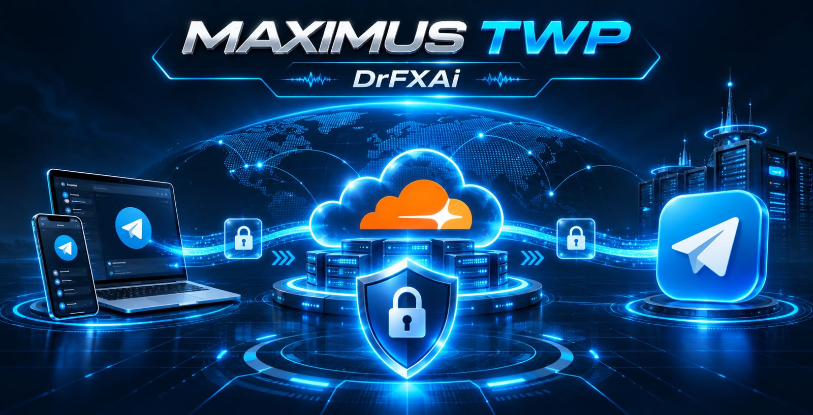
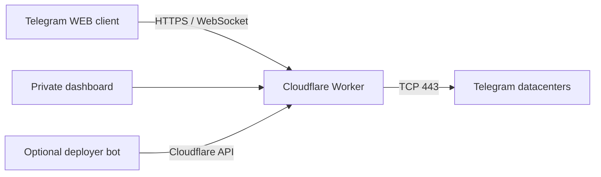

<div align="center">


# MAXIMUS TWP

**پروکسی WEB تلگرام روی Cloudflare Workers، بدون نیاز به VPS**

[English](README.md) · **فارسی**

[نصب آسان](#نصب-آسان) · [ربات نصب](#ربات-نصب-maximus-twp) · [معماری](#معماری) · [پرسشهای-متداول](#پرسشهای-متداول)

</div>

## معرفی

MAXIMUS TWP پروژه‌ای مستقل از DrFXAi است که قابلیت انتقال **ترافیک WEB Proxy تلگرام** را با استفاده از Cloudflare Workers فراهم می‌کند. ارتباط در سمت کلاینت از طریق HTTPS/WebSocket و در سمت دیتاسنترهای مجاز تلگرام از طریق TCP انجام می‌شود.

**توجه:** این پروژه VPN کامل دستگاه، پراکسی SOCKS یا سرور VLESS نیست. برای استفاده به نسخه‌ای از کلاینت تلگرام نیاز دارید که WEB Proxy را پشتیبانی کند. عملکرد واقعی باید پس از نصب آزمایش شود.



## ویژگی‌ها

- اجرای Serverless روی Workers بدون نیاز به VPS و دیتابیس
- تولید لینک اتصال `tg://webproxy` و لینک قابل اشتراک‌گذاری `t.me/webproxy`
- داشبورد مدیریت خصوصی با رمز جداگانه
- احراز هویت HMAC و نشست‌های کوتاه‌مدت
- پشتیبانی از ارتباط WebSocket و جریان‌های چندگانه
- ربات نصب اختیاری با زبان پیش‌فرض انگلیسی و گزینه فارسی
- تست‌های خودکار و کنترل کیفیت GitHub Actions

## نصب آسان

**پیش‌نیاز:** حساب Cloudflare، نصب Node.js نسخه ۲۰ یا بالاتر و دسترسی به ترمینال.

1. مخزن را دانلود کرده و وارد پوشه شوید:

   ```bash
   git clone https://github.com/drfxai/TWP.git
   cd TWP
   npm install
   npx wrangler login
   ```

2. دو کلید **مجزا** تولید کنید. ابتدا کلید پروکسی با ۱۶ بایت تصادفی:

   ```bash
   node -e "console.log(require('node:crypto').randomBytes(16).toString('hex'))"
   ```

   سپس کلید مدیریت با ۳۲ بایت تصادفی:

   ```bash
   node -e "console.log(require('node:crypto').randomBytes(32).toString('hex'))"
   ```

3. کلیدها را در Cloudflare ثبت و Worker را منتشر کنید:

   ```bash
   npx wrangler secret put PROXY_SECRET
   npx wrangler secret put ADMIN_TOKEN
   npm run deploy
   ```

   پس از هر دستور `secret put`، کلید متناظر را در ترمینال وارد کنید. **کلیدها را داخل کد یا مخزن GitHub قرار ندهید.**

4. آدرس خروجی `workers.dev` را باز کنید، کلید `ADMIN_TOKEN` را در پنل وارد کنید و لینک تلگرام را بسازید. لینک را در نسخه سازگار تلگرام امتحان کنید.

جزئیات و حل مشکلات: [راهنمای قدم‌به‌قدم فارسی](docs/QUICKSTART.fa.md).

## ربات نصب MAXIMUS TWP

در پوشه [`deployer/`](deployer/) سورس ربات اختیاری وجود دارد. پس از اتصال توکن ربات **به‌صورت Secret در Cloudflare** و ثبت Webhook، ربات می‌تواند راهنمای نصب را به انگلیسی یا فارسی نمایش دهد و فرم امن استقرار ارائه کند. این ربات پیش از انجام تنظیمات، فعال نیست.

برای امنیت، **توکن API کلادفلر نباید در چت ربات ارسال شود**. کاربر توکن محدود به یک حساب و دسترسی Workers Scripts Edit را در صفحه HTTPS ورود اطلاعات وارد می‌کند. اطلاعات توکن در دیتابیس ذخیره نمی‌شود.

[راهنمای راه‌اندازی ربات](docs/BOT_DEPLOYER.md)

## معماری



## پرسش‌های متداول

**آیا جایگزین VPN است؟** خیر؛ فقط ترافیک WEB Proxy تلگرام را منتقل می‌کند.

**بدون ربات هم کار می‌کند؟** بله؛ نصب با دستورات Wrangler مستقل از ربات است.

**آیا رایگان است؟** می‌توانید در چارچوب سهمیه Cloudflare آزمایش کنید؛ محدودیت‌ها و قیمت‌گذاری را بررسی کنید.

**آیا اتصال تضمینی است؟** خیر؛ باید سازگاری کلاینت، شبکه و اتصال واقعی تا دیتاسنتر بررسی شود.

**وضعیت نسخه:** پیش‌نمایش مهندسی؛ موفقیت تست‌های کد به‌تنهایی به معنی تأیید اتصال واقعی تلگرام نیست.

© 2026 DrFXAi · مجوز [MIT](LICENSE)
