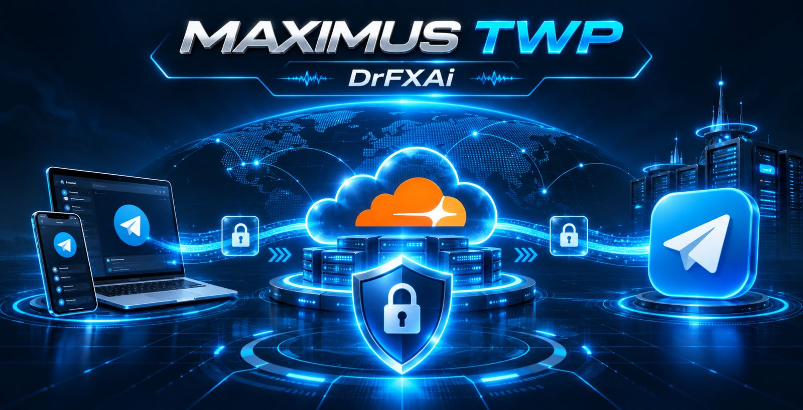
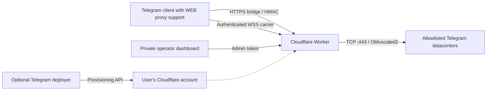

<div align="center">


# MAXIMUS TWP

**A self-hosted, serverless Telegram WEB Proxy relay for Cloudflare Workers.**

[](https://github.com/drfxai/TWP/actions/workflows/verify.yml)
[](https://developers.cloudflare.com/workers/)
[](LICENSE)
[](#compatibility--release-status)

**English** · [فارسی](README.fa.md)

[Quick start](#quick-start) · [Telegram deployer](#telegram-deployer-bot) · [Architecture](#architecture) · [Security](#security) · [FAQ](#faq)

</div>

---

## About

MAXIMUS TWP is an independent Cloudflare Workers implementation of a Telegram WEB proxy relay. The Worker accepts a signed WebView bridge session, multiplexes binary streams over WebSocket, and forwards eligible MTProto traffic to a constrained allowlist of Telegram datacenter endpoints.

**Important:** This is a **Telegram-only transport**, **not** a general-purpose VPN, SOCKS server, or VLESS service. It is designed for integration with the larger MAXIMUS VPN ecosystem, but using TWP does not route other Android apps through MAXIMUS VPN.



## Key capabilities

| Area | Implementation |
| --- | --- |
| Deployment | Cloudflare Worker; no dedicated VPS or SQL database |
| Telegram entry | `tg://webproxy` and `https://t.me/webproxy` links |
| Relay | HTTPS bootstrap + authenticated WebSocket carrier |
| Transport | Stream multiplexing, flow-control frames and TCP DC routing |
| Access control | Random `PROXY_SECRET`, dedicated `ADMIN_TOKEN`, short-lived HMAC sessions |
| Administration | Private operator dashboard; secret-backed link generation |
| Provisioning | Optional, separately deployed Telegram deployer bot with bilingual UI |
| Internationalization | English-first docs; [Persian guide](README.fa.md) and bilingual bot |
| Validation | Protocol/service tests, build check and GitHub Actions CI |

## Quick start

**Requirements:** a Cloudflare account, Node.js 20+, and a Telegram client build that actually supports the WEB proxy protocol.

```bash
git clone https://github.com/drfxai/TWP.git
cd TWP
npm install
npx wrangler login
```

Create a unique proxy secret (32 hex characters):

```bash
node -e "console.log(require('node:crypto').randomBytes(16).toString('hex'))"
```

Create a **different**, high-entropy admin token (64 hex characters):

```bash
node -e "console.log(require('node:crypto').randomBytes(32).toString('hex'))"
```

Install both as **Cloudflare secrets** (not in GitHub or `wrangler.toml`):

```bash
npx wrangler secret put PROXY_SECRET
npx wrangler secret put ADMIN_TOKEN
npm run deploy
```

At each prompt paste the value generated for that specific secret. Open the resulting `https://<worker>.<subdomain>.workers.dev` URL in a browser, enter the admin token and generate the connection link. On a supported Telegram client, open the `tg://webproxy` link.

> **Do not use a hard-coded example key.** Successful deployment or a healthy HTTP endpoint does **not** prove Telegram connectivity. See [the verification checklist](docs/QUICKSTART.md#verify-the-deployment).

**Alternative guides:** [Full English setup](docs/QUICKSTART.md) · [آموزش نصب فارسی](docs/QUICKSTART.fa.md) · [Troubleshooting](docs/QUICKSTART.md#troubleshooting).

## Telegram deployer bot

The repository includes an **optional deployer bot** in [`deployer/`](deployer/). Once configured with **your own Telegram bot token**, it can guide users in English or Persian to a protected HTTPS form and deploy a private MAXIMUS TWP Worker into their Cloudflare account.

The user enters their Cloudflare API token **only in the HTTPS form**, never in Telegram chat. The form requests a token restricted to **Workers Scripts: Edit** for **one account**, and the backend does not save it to a database or put it in Telegram messages.

The bot is **not live until you deploy it and register its Telegram webhook**. It is *not* the publicly accessible bot shown in third-party screenshots. See [Deployer setup and security](docs/BOT_DEPLOYER.md).

## Architecture



- [`src/worker.js`](src/worker.js): HTTP routes, bootstrap/session authorization and WebSocket upgrade.
- [`src/carrier.js`](src/carrier.js): stream lifecycle, multiplexing and flow control.
- [`src/datacenter.js`](src/datacenter.js): allowlisted Telegram DC connectivity and MTProto Obfuscated2 handling.
- [`src/security.js`](src/security.js): cryptography and stateless authentication.
- [`src/dashboard.js`](src/dashboard.js): administrator UI.
- [`deployer/`](deployer/): optional self-hosted Telegram deployment assistant.

Detailed design: [Architecture](docs/ARCHITECTURE.md) · [MAXIMUS integration](docs/MAXIMUS_INTEGRATION.md).

## Security

- Restrict Cloudflare API tokens to one account and Workers Scripts write access; use short expiration where practical.
- Never paste Cloudflare or Telegram bot tokens in Telegram conversations, public issues, source control or screenshots.
- Use separate proxy, admin, webhook and setup-signing secrets. Rotate compromised credentials immediately.
- A proxy link includes an access secret. Treat it as a credential; revoke by rotating `PROXY_SECRET`.
- This software does **not** promise anonymity, censorship immunity, a guaranteed speed increase, or compatibility across all Telegram versions.

See [security and threat model](docs/SECURITY.md).

## Compatibility & release status

**Engineering preview · v0.2.0 documentation/deployer milestone.** Automated protocol tests and packaging checks are not a substitute for a live Telegram client test. Actual availability depends on client WEB-proxy support, Cloudflare egress, network conditions and Telegram behavior. No blanket claim of “DPI immune” or “zero latency” is made.

## FAQ

**Is this the same as a VPN?** No. It relays Telegram WEB-proxy traffic only.

**Can I deploy it without a Telegram bot?** Yes. The CLI flow above is the recommended starting point and needs no bot.

**Does this require a paid Cloudflare plan?** Not necessarily for a small proof of concept. Cloudflare platform quotas and availability can change; verify the current plan before production use.

**Why is the deployer separate?** It reduces the attack surface of the proxy Worker and lets operators run the bot only when needed.

**What if the link opens Telegram but no connection is established?** Check WEB-proxy client support, WSS handshake, DC connectivity and runtime logs; refer to the [troubleshooting guide](docs/QUICKSTART.md#troubleshooting).

## Contributing & responsible disclosure

Issues and reproducible test results are welcome. Never post active connection secrets or access tokens. For a suspected vulnerability, contact the maintainers privately rather than publishing credentials or exploit details.

Copyright © 2026 **DrFXAi**. Released under the [MIT License](LICENSE).
